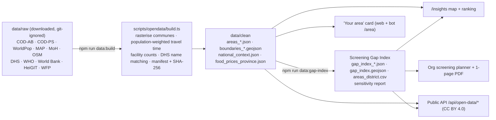

# SokhaPheap (សុខភាព)

SokhaPheap is a Khmer-first web app and Telegram bot that helps Cambodian adults **understand their health risk early and get to care**. It was built for the Open Data × AI Venture Hackathon in Phnom Penh, with Demo Day on 26 December 2026.

1. **Risk check:** a short questionnaire calculates type 2 diabetes risk (FINDRISC) and 10-year heart attack and stroke risk (WHO 2019 non-laboratory chart, South-East Asia).
2. **Blood test explainer:** a photo of a lab report goes to AI, which reads the values. The user confirms or edits them, the app compares them with the range printed on the report or with guideline ranges, and AI explains the result in simple Khmer.
3. **Next step and facility map:** every result ends with a clear next step and the nearest hospitals, health centres and clinics, built from **Cambodian open data**.

> ⚠️ នេះមិនមែនជាការធ្វើរោគវិនិច្ឆ័យទេ។ សូមពិគ្រោះជាមួយវេជ្ជបណ្ឌិត។ This is not a diagnosis. Please consult a doctor.

## Architecture

```
Browser (Next.js, km/en) ─┐                ┌─ src/lib/scoring   FINDRISC · WHO CVD table · lab ranges   (pure code, no AI)
Telegram (@SokhaPheapBot) ┼─► Next.js API ─┼─ src/lib/ai        Gemini: lab extraction + explanation    (fallback: templates)
GitHub Actions (daily) ───┘   routes       ├─ src/lib/facilities  data/clean/facilities.geojson         (open data)
                                           └─ Supabase          facilities (public read) · screenings · reminders · organizations (RLS)
```

- **Risk is calculated by code, never by AI.** AI only reads lab photos and explains results it is given. Explanation output is filtered for drug names, doses, diagnoses and stray non-Khmer scripts. If it fails the filter, the next model is tried, then a fixed template.
- **No personal data.** Screenings are saved with score bands, province and an optional org code only. Lab photos are processed in memory and discarded.
- **Works without AI or the database.** Explanations fall back to templates, and facility search falls back to the bundled open-data file.

| Layer | Choice |
|---|---|
| App and API | Next.js 16 (App Router), TypeScript, Tailwind 4 |
| Database | Supabase Postgres with RLS. The anon key can only read `facilities`. |
| AI | Google Gemini via `@google/genai`. `AI_MODEL` (default `gemini-3.8-flash`), with `AI_MODEL_FAST` (`gemini-3.5-flash-lite`) as fallback. |
| Map | Leaflet and react-leaflet, OpenStreetMap tiles, canvas markers |
| Bot | grammy, webhook at `/api/telegram` (secret token), long polling for local dev |
| Tests | Vitest (unit and API), Playwright-core with Edge (UI e2e, axe accessibility) |
| Hosting | Render free Web Service (Singapore) via `render.yaml`. Daily reminders run from GitHub Actions. |

## Open data

Open data is used throughout SokhaPheap: in the facility map, the personal results, the organisation planner and a public API. **12 open datasets from 11 publishers.** Every number shown in the app comes from a downloaded dataset, processed by a script in `/scripts` into `/data/clean`. Provenance (URL, licence, data year, SHA-256 of each raw file) is in [`data/manifest.json`](data/manifest.json). The checks are in [`data/clean/data_quality_report.md`](data/clean/data_quality_report.md), and the full inventory with what was not available is in [`data/INVENTORY.md`](data/INVENTORY.md).

| Dataset | Publisher | Year | Licence | Used for |
|---|---|---|---|---|
| Admin boundaries (COD-AB): 25 provinces, 197 districts, 1,633 communes | OCHA / MLMUPC, via HDX | 2024 | CC BY-IGO | Geography for every join; maps; "Your area" lookup |
| Population statistics (COD-PS) | UNFPA / NIS, via HDX | 2024 | CC BY-IGO | Official totals, adult share; WorldPop cross-check |
| Population counts, 100 m (WorldPop R2025A) | WorldPop, via HDX | 2025 | CC BY 4.0 | District/commune population; population weights |
| Travel time to healthcare, motorised and walking (Weiss et al. 2020) | Malaria Atlas Project | 2019 | CC BY 4.0 (to be confirmed) | Travel times; % beyond 1 h walk / 30 min motor |
| Health facilities | Ministry of Health, via HDX | 2010 | Not stated | Facility map, counts, nearest care |
| Health facilities (OpenStreetMap export) | HOT / OSM contributors, via HDX | 2026 | ODbL 1.0 | Facility map, counts, nearest care |
| DHS 2021–22 subnational indicators (aggregated, no microdata) | The DHS Program / NIS / MoH | 2021–22 | DHS terms | Province risk factors, insurance, distance problem, poverty |
| Noncommunicable disease indicators (GHO) | WHO | 2019–2025 | CC BY-NC-SA 3.0 IGO | National context (diabetes, hypertension, overweight…) |
| CVD risk chart, South-East Asia (HEARTS) | WHO | 2020 | CC BY-NC-SA 3.0 IGO | Heart risk score |
| Health indicators | World Bank, via HDX | 2023 | CC BY 4.0 | Health spending context |
| Accessibility indicators | HeiGIT, via HDX | 2026 | CC BY-SA | Cross-check of travel times |
| Food prices | WFP, via HDX | 2025–26 | CC BY-IGO | Vegetable price tip per province |



**Rebuild everything:** `npm run data:build` (about 30 seconds; downloads anything missing). Two runs give byte-identical outputs.

**Screening Gap Index** (`src/lib/insights/gapIndexConfig.ts`): five equally weighted parts.
- **Risk:** DHS women overweight, men and women smoking.
- **Access:** MAP travel time, % more than 1 h walk, DHS "distance is a problem".
- **Capacity:** facilities per 10,000 people, inverted.
- **People:** adults 20+.
- **Poverty:** DHS lowest wealth quintile.

Each indicator is capped at the 5th–95th percentile and min-max scaled to 0–1; the index is 100 × the weighted mean. Sensitivity: `data/clean/gap_index_sensitivity.md` (median top-10 overlap 8/10 across 16 variants). **It is a planning tool, not a measure of anyone's health.**

## Run locally

```bash
npm install
cp .env.example .env          # fill in the keys
npm run dev                   # http://localhost:3000  (/km and /en)

npm test                      # unit + API tests
npm run test:coverage         # scoring coverage (target ≥ 90%)
npm run build && npx next start -p 3100
BASE_URL=http://localhost:3100 npm run test:e2e   # 10 FINDRISC cases through the UI + axe a11y
BASE_URL=http://localhost:3100 npx tsx tests/e2e/insights.e2e.ts   # insights: 3G, spot checks, downloads (also planner.e2e.ts)

npm run data:facilities       # re-download + rebuild facilities.geojson
npm run data:build            # whole open-data pipeline: facilities + areas + gap index (data/clean, manifest)
npm run data:who-chart        # regenerate the WHO table from the official PDF
npm run db:migrate            # apply supabase/migrations + seed facilities (needs SUPABASE_DB_URL, session pooler)
npm run ai:eval               # extraction accuracy + tricky questions + Khmer samples (uses Gemini)
npm run bot:dev               # Telegram bot in long-polling mode (deletes webhook)
npm run bot:webhook           # point the bot back at NEXT_PUBLIC_SITE_URL/api/telegram
```

## Deploy (Render)

1. Push to GitHub.
2. In Render: **New → Blueprint**, select the repo, and enter each env var when prompted. They are never committed.
3. After the first deploy, set `NEXT_PUBLIC_SITE_URL=https://<name>.onrender.com` in Render and in your local `.env`, then run `npm run bot:webhook`.
4. In GitHub, go to **Settings → Secrets → Actions** and add `APP_URL` and `CRON_SECRET` for the daily reminder workflow.

The free plan sleeps after 15 minutes without traffic, so the first request afterwards can take up to about a minute. Warm the app up before demos (see `DEMO_SCRIPT.md`).

## Deploy (GitHub Pages, static frontend)

`.github/workflows/pages.yml` builds a static export on every push to `main` and publishes it to https://arunratanak.github.io/Sokhapheap/. Pages can't run server code, so:

- The `/api` routes stay on Render. The browser calls them at `NEXT_PUBLIC_API_BASE`, which defaults to the Render URL and can be overridden with the repo variable `API_BASE_URL`. Render allows these cross-origin calls from `https://arunratanak.github.io`. To allow other origins, set `CORS_ORIGINS` (comma-separated) in Render.
- The organisation dashboards (`/[lang]/org/[code]`) and the social preview image are only on Render.
- One-time setup: **Settings → Pages → Source: GitHub Actions**.

`scripts/build_pages.sh` deletes the server-only files before building, so run it only in CI or in a throwaway copy.

## Limitations

- FINDRISC and the WHO charts were **developed outside Cambodia** and have not been validated in the Cambodian population. The WHO chart is for ages 40–74 only.
- Part of the facility data is **from 2010**. OSM coverage is uneven and includes some mislabelled places, such as offices tagged as hospitals.
- Lab "normal ranges" vary between laboratories. The app prefers the range printed on the report. The fallback table needs clinician sign-off (see `REVIEW.md`).
- Bot conversation state is held in memory, so it's lost if the free instance restarts mid-conversation.
- The in-memory rate limiter resets on restart. That's acceptable for one instance.

## Known issues and roadmap

See [`REVIEW.md`](REVIEW.md) for open items. The roadmap is built on the open datasets above:

- **Facility data:** replace the **Ministry of Health 2010** facility list with newer official data when it is published, and refresh the **OpenStreetMap health facilities (HOT export)** every month.
- **Blood pressure and blood sugar:** add province-level data from the next **Cambodia DHS** or **WHO STEPS** survey, so the gap index can include them. Not available in DHS 2021–22.
- **Yearly refresh:** update travel times (**Malaria Atlas Project**, **HeiGIT**) and population (**WorldPop**, **COD-PS / NIS**) each year with `npm run data:build`.
- **Food tips:** use **WFP food prices** to give affordable healthy food tips in every province.
- **Validation:** validate the **Screening Gap Index** against real screening results with NGO partners.
- **Asian FINDRISC cut-offs:** they need validation, so they are disabled for now.
- **Laboratory-based WHO chart:** with cholesterol and diabetes status.
- **Bot state:** store the bot language preference and conversation state in Supabase.
- **Village search:** add it if a complete village dataset with Khmer names becomes available. The OSM populated places file has about 4,700 places and no Khmer names.
